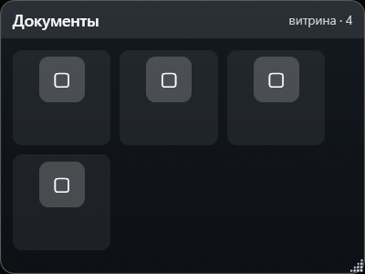

# Витрины

**Витрины** — приложение для Windows, которое автоматически сортирует файлы, ярлыки и программы в «стеклянные» мини-контейнеры на рабочем столе.  
Новые файлы не теряются в хаосе: они «улетают» в подходящую витрину, а если подходящей нет — создаётся новая. При этом остаётся полный ручной контроль: правила, перенос между витринами, закрепление важных элементов и работа с обычными папками проводника.

> Сделано в подходе *clean room*: поведение и механики реализованы самостоятельно, без копирования чужого кода и ассетов.

## Как это выглядит

### Стеклянные витрины на рабочем столе
Витрины — это полупрозрачные контейнеры поверх рабочего стола: их можно двигать, менять размер, перетаскивать в них файлы и переносить элементы между витринами. Витрина может быть **коллекцией** (упорядоченные элементы) или **порталом** на реальную папку проводника.

<p align="center">
  
  
  
</p>
<p align="center">
  
  
  
</p>

### Панель управления
Панель позволяет управлять автоматикой безопасно: проверять результат через dry-run, разбирать уже существующие файлы, настраивать источники и правила, смотреть журнал действий и откатывать перемещения.

<p align="center">
  
</p>

## Возможности

### Автоматическая сортировка
- **Наблюдение за папками-источниками** (по умолчанию: Рабочий стол и Загрузки) — новые файлы обрабатываются автоматически, когда автоматика включена.
- **Физическая сортировка «куда нужно»**: файлы действительно перемещаются, а не просто помечаются.
  - для витрин-коллекций — в управляемую папку витрины;
  - для витрин-порталов — в выбранную реальную папку проводника.
- **Автосоздание витрин**: если подходящей витрины нет, она создаётся по правилу/категории.
- **Разобрать сейчас** — явный разбор уже существующих файлов в источниках по текущим правилам.
- **Dry-run** — проверка папки без изменений: видно, что и почему будет перемещено.

### Надёжность и безопасность автоматики
- **Безопасный дефолт**: автоматическая сортировка выключена, пока вы явно не включите её.
- **Обработка только готовых файлов**: детектор стабильности + игнор временных/незавершённых расширений (`.crdownload`, `.part`, `.tmp`, …), чтобы не трогать загрузки «в процессе».
- **Защита от петель и повторов**: собственные перемещения помечаются, управляемое хранилище не сканируется повторно.
- **Безопасные файловые операции**: при конфликте имён файл переименовывается, а не перезаписывается.
- **Журнал и откат**: каждое действие фиксируется с причиной/правилом, последнее перемещение можно отменить.
- **Закрепление вручную**: закреплённые элементы автоматика не перемещает.

### Витрины и ручное управление
- **Два режима витрины**:
  - *Коллекция* — управляемый набор элементов;
  - *Портал* — живое отражение содержимого реальной папки проводника.
- **Перетаскивание**: бросьте файлы в витрину (в коллекцию — в её хранилище, в портал — в папку портала).
- **Перенос между витринами**: перетащите элемент из одной витрины в другую (в портал — реальное перемещение файла).
- **Меню витрины**: переименовать, удалить витрину (файлы на диске не удаляются), сделать порталом/коллекцией, открыть папку (портала или хранилища).
- **Меню элемента**: открыть, показать в папке, закрепить/открепить, убрать из витрины.
- **Свободная раскладка**: окна-витрины можно двигать и менять в размере — позиция и размер сохраняются.

### Настройка
- **Источники наблюдения**: добавление и удаление папок, за которыми следит сортировка.
- **Правила**: включение/выключение, удаление и добавление правил (по расширениям и целевой витрине), порядок/приоритет применения. Доступны стартовые пресеты (изображения, документы, архивы, установщики, ярлыки).
- **Прозрачность**: вкладки «Сводка», «Dry-run», «Журнал», «Правила» в панели управления.

## Как это устроено

| Компонент | Назначение |
|---|---|
| `Vitrines.Core` | Домен без UI: модели витрин/элементов/правил, движок правил, наблюдатель ФС, безопасные файловые операции, хранилище, оркестратор сортировки |
| `Vitrines.App` | Настольное приложение (WPF): «стеклянные» окна-витрины на рабочем столе и панель управления |
| `docs/PLAN.md` | Концепция, clean-room анализ механик/недостатков и дорожная карта |

Данные и конфигурация хранятся локально в `%LOCALAPPDATA%\Vitrines\` (открытый JSON):

- `settings.json` — источники, стабильность, временные расширения, состояние автоматики;
- `layout.json` — витрины, элементы, позиции/размеры;
- `rules.json` — правила сортировки;
- `history.jsonl` — журнал действий;
- `storage\` — управляемые папки витрин-коллекций (куда физически сортируются файлы).

## Быстрый старт

1. Запустите приложение (`Vitrines.App.exe`).
2. Нажмите **«Показать витрины»** — на рабочем столе появятся витрины-категории.
3. Проверьте **Источники** и **Правила** во вкладках панели.
4. Выполните **Dry-run** для выбранной папки, чтобы увидеть будущие действия без изменений.
5. Нажмите **«Разобрать сейчас»** для существующих файлов и/или включите **«Автоматическая сортировка»** для новых.
6. При необходимости настройте вручную: создайте портал на реальную папку, перетаскивайте элементы между витринами и закрепляйте важное.

> Совет: начинайте с dry-run — автоматика прозрачна и обратима, но лучше заранее увидеть результат.

## Сборка

Требования: Windows, .NET SDK 8+ (проект также собирается на SDK 10).

```powershell
# из корня репозитория
dotnet build .\src\Vitrines.App\Vitrines.App.csproj -c Debug
# или релиз
dotnet build .\src\Vitrines.App\Vitrines.App.csproj -c Release
```

Запуск собранного приложения:
`src\Vitrines.App\bin\<Configuration>\net8.0-windows\Vitrines.App.exe`

## Ограничения и планы

- Эффект «стекла» реализован как полупрозрачность + blur там, где он доступен в системе (не системный Acrylic/Mica на всех конфигурациях).
- Редактор правил базовый (расширения/целевая витрина, без сложного конструктора условий и перестановки в UI).
- Для элементов используются системные иконки файлов; иконки папок могут отображаться упрощённо.
- Дальше по плану: более глубокие условия правил и политика для коллекций, анимации «перелёта», улучшенный визуал (Acrylic/Mica), устойчивость на мульти-мониторе/DPI и экспорт/импорт настроек (см. `docs/PLAN.md`).

## Лицензия

Лицензия не указана. Если планируете открытое использование/вклад — добавьте файл `LICENSE`.
