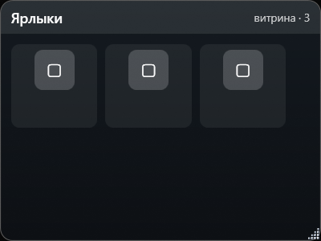
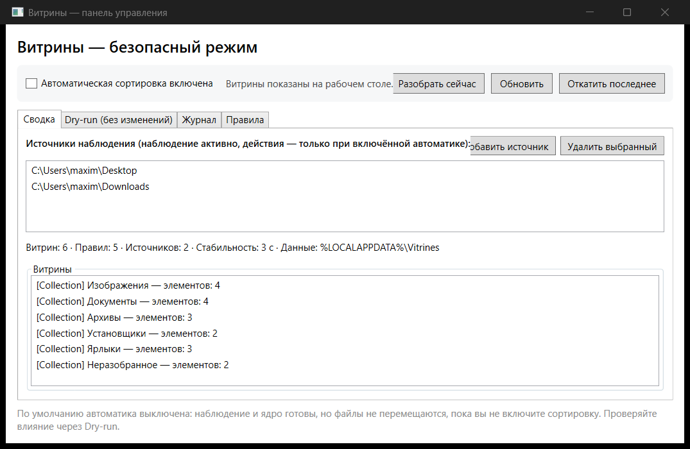

# Витрины

**Витрины** — приложение для Windows, которое автоматически сортирует файлы, ярлыки и программы в «стеклянные» мини-контейнеры на рабочем столе.  
Новые файлы не теряются в хаосе: они «улетают» в подходящую витрину, а если подходящей нет — создаётся новая. При этом остаётся полный ручной контроль: гибкие правила, «Неразобранное» для спорных случаев, перенос между витринами, закрепление важных элементов и работа с обычными папками проводника.

> Сделано в подходе *clean room*: поведение и механики реализованы самостоятельно, без копирования чужого кода и ассетов.

## Как это выглядит

### Стеклянные витрины на рабочем столе
Витрины — это полупрозрачные контейнеры поверх рабочего стола: их можно двигать, менять размер, перетаскивать в них файлы и переносить элементы между витринами. Витрина может быть **коллекцией** (упорядоченные элементы) или **порталом** на реальную папку проводника.

<p align="center">
  
  
  
</p>
<p align="center">
  
  
  
</p>

### Панель управления
Панель позволяет управлять автоматикой безопасно: проверять результат через dry-run (по папке и по всем источникам), разбирать уже существующие файлы, настраивать источники и мощные правила, разбирать «Неразобранное», смотреть фильтруемый журнал действий, откатывать перемещения (в том числе несколькими шагами), менять оформление, вести профили настроек и делать снапшоты конфигурации.

<p align="center">
  
</p>

## Возможности

### Автоматическая сортировка
- **Наблюдение за папками-источниками** (по умолчанию: Рабочий стол и Загрузки) — новые файлы обрабатываются автоматически, когда автоматика включена.
- **Рекурсивное наблюдение** (опционально) для подпапок источников.
- **Физическая сортировка «куда нужно»**: файлы действительно перемещаются, а не просто помечаются.
  - для витрин-коллекций — в управляемую папку витрины;
  - для витрин-порталов — в выбранную реальную папку проводника.
- **Режим ссылок**: альтернатива перемещению — элементы остаются на месте, а витрина хранит ссылки на них.
- **Автосоздание витрин**: если подходящей витрины нет, она создаётся по правилу/категории.
- **Разобрать сейчас** — явный разбор уже существующих файлов во всех источниках по текущим правилам.
- **Расписание** — периодический разбор существующих файлов (интервал настраивается, по умолчанию выключен).
- **Dry-run** — проверка без изменений: по выбранной папке или сразу по всем источникам (видно, что и почему будет сделано).

### Мощные правила
- **Условия:** расширения, тип (файл/папка/ярлык/приложение), имя содержит, маски `* ?`, регулярное выражение, размер (мин/макс), даты, ограничение по конкретным источникам.
- **Исключения:** внутри правила (расширения/имя/маски/папки) и **глобальные «не трогать»** (папки, расширения, фрагменты имени) в настройках.
- **Правила-исключения:** совпавшие элементы гарантированно не трогаются.
- **Приоритет и порядок:** правила применяются сверху вниз (первое совпадение); порядок меняется перетаскиванием, кнопками выше/ниже и сразу отражается в списке, есть быстрый и расширенный визуальный редактор, вкл/выкл и пресеты.
- **Действия:** поместить/создать витрину, переместить в папку, отправить в «Неразобранное», игнорировать.
- **Шаблоны имён:** переименование при сортировке (`{name}`, `{ext}`, `{date}`, `{yyyy}`, `{MM}`, `{dd}`, `{HH}`, `{mm}`, `{ss}`, `{counter}` и др.) с безопасной очисткой недопустимых символов.
- **Политика для неподошедших:** игнорировать, отправлять в «Неразобранное» или класть в витрину по умолчанию.

### Доверие и контроль
- **«Неразобранное» (инбокс):** сюда попадают элементы, которые не подошли под правила (по политике) или не удалось обработать, — с причиной и быстрыми действиями (отправить в витрину, показать в папке, скрыть/очистить).
- **Правило из инбокса:** по выбранному элементу можно сразу создать правило (расширение/тип/имя подставляются автоматически) и применить его.
- **Журнал «что, куда и почему»:** событие, правило, источник, причина; **фильтры** по типу события и тексту.
- **Локальный аудит:** отдельная запись пропусков в журнал (по желанию) — видно, почему элемент не был обработан.
- **Откат:** отмена последнего и нескольких действий (мульти-undo) с обновлением витрин/ссылок; история хранится в `history.jsonl`.
- **Закрепление вручную:** закреплённые элементы автоматика не перемещает.

### Надёжность и безопасность автоматики
- **Безопасный дефолт**: автоматическая сортировка выключена, пока вы явно не включите её.
- **Обработка только готовых файлов**: детектор стабильности (настраиваемый) + игнор временных/незавершённых расширений, чтобы не трогать загрузки «в процессе».
- **Защита от петель и повторов**: собственные перемещения помечаются, управляемое хранилище не сканируется повторно.
- **Безопасные файловые операции**: политика конфликтов имён на выбор — переименовать, пропустить или заменить; по умолчанию файл переименовывается, а не перезаписывается.
- **Повторы при блокировке**: настраиваемое число повторов для занятых файлов.
- **Понятные ошибки:** сбои фиксируются в журнале и попадают в «Неразобранное» с причиной.

### Витрины и ручное управление
- **Два режима витрины**: *Коллекция* — управляемый набор элементов; *Портал* — живое отражение содержимого реальной папки проводника.
- **Перетаскивание**: бросьте файлы в витрину (в коллекцию — в её хранилище, в портал — в папку портала).
- **Перенос между витринами**: перетащите элемент из одной витрины в другую (в портал — реальное перемещение файла).
- **Меню витрины**: переименовать, удалить (файлы на диске не удаляются), сделать порталом/коллекцией, открыть папку (портала/хранилища), настроить прозрачность.
- **Меню элемента**: открыть, показать в папке, закрепить/открепить, убрать из витрины.
- **Свободная раскладка**: окна-витрины можно двигать и менять размер — позиция и размер сохраняются; расположение корректируется в пределах видимой области экранов.

### Кастомизация и устойчивость
- **Внешний вид:** акцентный цвет, размер плиток, плотность (compact/normal/comfortable), масштаб шрифта, анимации, прозрачность; темы `dark`/`light`/`glass`; Acrylic/Blur для витрин там, где он доступен в системе.
- **Поведение на рабочем столе:** витрины можно закрепить на нижнем слое (не перекрывают обычные окна) и включить режим «не активировать» (клики не забирают фокус), с перепривязкой при перезапуске оболочки и смене конфигурации мониторов.
- **Профили и снапшоты:** именованные профили настроек (создать/переименовать/восстановить/удалить) и экспорт/импорт `layout/rules/settings/inbox/history` в zip.
- **Мульти-монитор и DPI:** позиции/размеры витрин корректируются в пределах видимой области экранов, манифест приложения включает PerMonitorV2 и long paths.
- **Сворачивание витрин:** витрину можно свернуть/развернуть (roll-up) из меню, состояние сохраняется.

## Как это устроено

| Компонент | Назначение |
|---|---|
| `Vitrines.Core` | Домен без UI: модели, движок правил (условия/исключения/объяснения), наблюдатель ФС, безопасные файловые операции, шаблоны имён, хранилище/профили, оркестратор сортировки, инбокс и история |
| `Vitrines.App` | Настольное приложение (WPF): окна-витрины на рабочем столе (DesktopLayerInterop, Acrylic/слой/DPI), визуальный редактор правил и панель управления (правила, инбокс, журнал, dry-run, вид, профили, экспорт/импорт) |
| `tests/Vitrines.Core.Tests` | Автотесты ядра (xUnit): правила, файловые операции, шаблоны имён, хранилище, профили/снапшоты |
| `docs/PLAN.md` | Концепция, clean-room анализ механик/недостатков и дорожная карта |

Данные и конфигурация хранятся локально в `%LOCALAPPDATA%\Vitrines\` (открытый JSON):

- `settings.json` — источники, стабильность, временные/глобальные исключения, рекурсия, политика для неподошедших, оформление, состояние автоматики;
- `layout.json` — витрины, элементы, позиции/размеры/стили;
- `rules.json` — правила сортировки;
- `inbox.json` — «Неразобранное»;
- `history.jsonl` — журнал действий;
- `storage\` — управляемые папки витрин-коллекций (куда физически сортируются файлы);
- `snapshots\` — именованные профили и авто-копии перед восстановлением.

Файлы `layout/rules/settings/inbox` сохраняются в версионированном формате (`schemaVersion=1`) с обратной совместимостью чтения старых данных; снапшоты содержат `manifest.json`. Подробный clean-room обзор обобщённых desktop-механик: `docs/CLEAN_ROOM_DESKTOP_MECHANICS.md`.

## Быстрый старт

1. Запустите приложение (`Vitrines.App.exe`).
2. Нажмите **«Показать витрины»** — на рабочем столе появятся витрины-категории.
3. Проверьте **Источники** (Сводка), **Правила** и **Вид и настройки** (политика для неподошедших, исключения, режим размещения, конфликты, расписание, оформление).
4. Выполните **Dry-run** (папка или все источники), чтобы увидеть будущие действия без изменений.
5. Нажмите **«Разобрать сейчас»** для существующих файлов и/или включите **«Автоматическая сортировка»** для новых; при необходимости включите расписание.
6. Следите за **Журналом** и **Неразобранным**: разбирайте спорные случаи, создавайте правила из инбокса, используйте откат при необходимости.
7. Сохраните удачную конфигурацию как **профиль** и при желании выгрузите снапшот.

> Совет: начинайте с dry-run — автоматика прозрачна и обратима, но лучше заранее увидеть результат.

Параметры запуска: `--show-vitrines`, `--scan`, `--exit` (удобно для автоматизированного разбора).

## Сборка

Требования: Windows, .NET SDK 8+ (проект также собирается на SDK 10).

```powershell
# из корня репозитория
dotnet build .\src\Vitrines.App\Vitrines.App.csproj -c Debug
# или релиз
dotnet build .\src\Vitrines.App\Vitrines.App.csproj -c Release
# автотесты ядра
dotnet test .\tests\Vitrines.Core.Tests\Vitrines.Core.Tests.csproj -c Debug
```

Запуск собранного приложения: `src\Vitrines.App\bin\<Configuration>\net8.0-windows\Vitrines.App.exe`

## Ограничения и планы

- Acrylic/Blur включается там, где это поддерживает система; при недоступности используется полупрозрачность. Витрины — самостоятельные top-level окна с закреплением в нижнем z-порядке и режимом «не активировать» (без `SetParent` в WorkerW), поэтому поведение может немного отличаться между сборками Windows.
- Перепривязка слоя выполняется при перезапуске оболочки, смене разрешения/DPI и конфигурации мониторов; в редких случаях помогает повторное «Показать витрины».
- Автоматика по умолчанию выключена; расписание работает только при включённой автоматике.
- Дальнейшая полировка: дополнительные действия правил, более глубокие визуальные эффекты и UX-сценарии (см. `docs/PLAN.md`).

## Лицензия

Лицензия не указана. Если планируете открытое использование/вклад — добавьте файл `LICENSE`.
